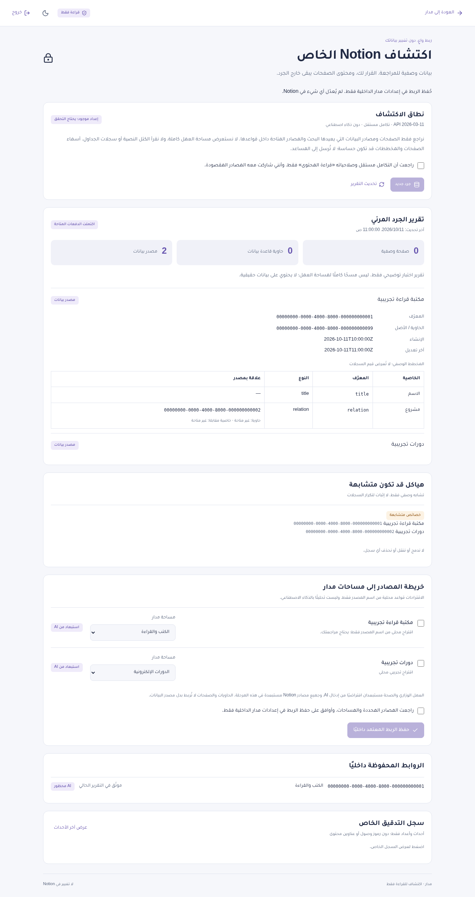
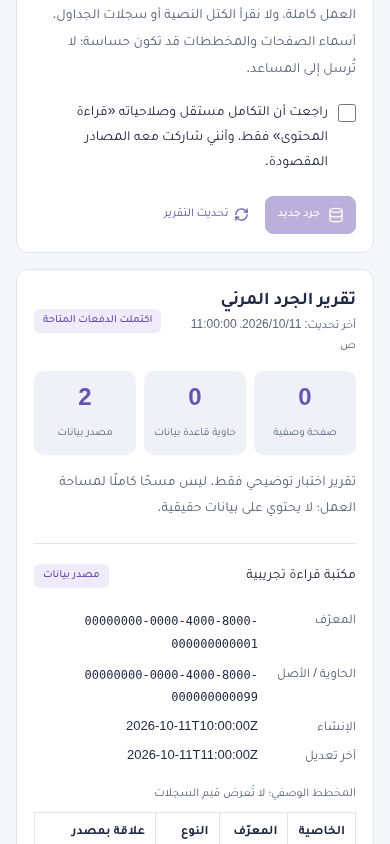

Current synchronization phase: site pages require owner authentication before rendering. This discovery integration remains strictly read-only; any approved single-record writes use a separate integration and workflow documented in [Notion sync](./notion-sync.md). No AI ingestion was enabled.

# Private, read-only Notion discovery

This feature extends the existing MADAR app. `/` remains the demo Life OS; `/discovery` is its subordinate private audit workflow. No existing Notion data was accessed while implementing or testing it. No integration, credentials, database, merge, or deployment is created automatically.

## What discovery actually does

The official `@notionhq/client` SDK is pinned to **5.27.0**, with an explicit **Notion-Version: 2026-03-11**. The SDK defaults to the older 2025-09-03 version, so relying on its default would be incorrect for this implementation.

- A **database** is a container that can contain multiple **data sources**. Each source owns its property schema and is the mapping unit. A database ID is not substituted for a data source ID.
- Search is paginated with `page_size=100` and `start_cursor`. Search discovers accessible indexed pages and data sources. Source schemas and database containers are retrieved separately. Sibling sources listed by an accessible database are retrieved only when the integration can access them; 403/404 produces a scope warning, not a claim of coverage.
- Parent container/source metadata is retrieved where accessible. Relation target IDs are recorded, but relations are **not followed** to expand scope or claim access to their targets.
- The report retains object kind, title, ID, parent ID, creation/edit timestamps, and property IDs/names/types/relation target IDs. It discards descriptions, actor/user details, URLs, icons, covers, formula expressions, options and non-title page property values. **Search can include page property values in its API response; these are discarded immediately except the title.** This is metadata minimization, not a promise that Notion never transmits any property values.
- Page blocks, page bodies, comments, row queries, exports, downloads, and page property-item endpoints are not allowed. Table rows are not enumerated. No AI service receives metadata or content.
- Search may omit recently shared or unindexed items; it is not a complete or strongly consistent workspace inventory. A final status means the available batches finished, not that every workspace object was scanned. Missing, partial and inaccessible results are visible in Arabic.
- Each owner-approved request processes at most four API calls, within a time budget. Calls are paced at least 400 ms apart. 429 honors Retry-After; retries are bounded, and long waits are persisted for a later manual resume. Transient 5xx has bounded exponential retries. Requests use timeouts and refuse redirects. A distributed lease serializes scans/mapping saves, and lease fencing prevents expired workers from overwriting a newer report or configuration.
- Safety caps: at most 1,000 inventoried/pending objects and 100 search cursors. A cap produces a partial report. The initial search and subsequent batches can be resumed rather than relying on one long Vercel request.

Official references:

- [Notion SDK version compatibility](https://github.com/makenotion/notion-sdk-js#requirements)
- [API versions](https://developers.notion.com/reference/changes-by-version)
- [Search](https://developers.notion.com/reference/post-search)
- [Retrieve a database](https://developers.notion.com/reference/retrieve-a-database)
- [Retrieve a data source](https://developers.notion.com/reference/retrieve-a-data-source)
- [Request limits](https://developers.notion.com/reference/request-limits)
- [Integration capabilities](https://developers.notion.com/reference/capabilities)

The current SDK's official README and installed endpoint types were checked. The documentation website returned 403 in the development environment; the official SDK repository was available. No real account/API request was used to compensate for that restriction.

## 1. Create a separate integration in Notion

Do this yourself in Notion's integration settings; the application cannot create an internal integration or independently inspect its capabilities through this discovery endpoint.

1. Open [Notion integrations](https://www.notion.so/profile/integrations) and create a **new internal integration**, for example `MADAR Read-only Discovery`. Do not reuse another tool's writable token.
2. In Capabilities, enable **Read content** only. Disable **Insert content**, **Update content**, comment capabilities, and user/email information access. Keep it private; no public OAuth/marketplace distribution is required.
3. Connect the integration only to deliberately selected, non-sensitive test pages/database containers first. Sharing a root can make its descendants accessible; review that scope. The app does not share pages on your behalf or request access to the entire workspace.
4. Put the new token in `NOTION_DISCOVERY_TOKEN` in the hosting provider's **server-side environment settings**. Never paste it into chat, the UI, a Git commit, browser storage, or a `NEXT_PUBLIC_*` variable.
5. Set `NOTION_DISCOVERY_READ_ONLY_ACK=1` only after reviewing the actual Notion capability panel. Also confirm that review in the UI before starting a scan. This is a manual acknowledgement, **not a runtime proof of platform permissions**. The transport guard independently blocks writes even if a wrongly configured token had write capabilities.

No write test should be attempted against real Notion data. All write-denial tests below use fake tokens and a mock upstream transport.

## 2. Configure private owner authentication and storage

This is a **single-owner** private audit area, with no public signup. It uses scrypt password verification, jose signed sessions, persisted hashed session IDs, and server-side authorization at every Notion endpoint. Sessions last 30 minutes, can be revoked on logout, and are checked against the internal database on every private request. Cookies are HttpOnly, SameSite=Strict, Path=/ and Secure with the `__Host-` prefix on HTTPS. HTTP is accepted only for explicit localhost development. No request Host header is trusted as the application origin.

Add these values securely to your deployment's environment settings. `.env.example` contains names only:

| Variable | Purpose |
| --- | --- |
| `MADAR_APP_ORIGIN` | Exact canonical origin, e.g. `https://your-private-preview.example`, without a trailing slash. Use the actual domain; public hosts require HTTPS. |
| `MADAR_OWNER_PASSWORD_HASH` | scrypt hash generated locally with the helper below; never the plaintext password. |
| `MADAR_SESSION_SECRET` | Independent random 32-byte secret encoded as 64 hex characters. |
| `MADAR_STORE_ENCRYPTION_KEY` | A **different** random 32-byte AES key encoded as 64 hex characters. Retain it securely: changing it prevents decryption of saved reports/mappings. |
| `DATABASE_URL` | Dedicated private PostgreSQL URL, using the provider's verified TLS settings (prefer `sslmode=verify-full` with a trusted CA). Do not disable TLS/certificate verification. |
| `NOTION_DISCOVERY_TOKEN` | New read-only integration token, server-only. |
| `NOTION_DISCOVERY_READ_ONLY_ACK` | `1` after reviewing read-only capabilities. |

Generate a password hash in a trusted **local terminal**:

```sh
npm run notion:password
```

The password is entered without echo, never as a command-line argument. Choose a unique 16–128 character password, store it in your password manager, and copy only the emitted hash into the server environment setting. Do not share the generated values in chat.

Generate **two independent keys**, running this locally once for each secret:

```sh
node -e 'console.log(require("node:crypto").randomBytes(32).toString("hex"))'
```

Local development may use an ignored `.env.local` file. The hash contains `$` characters: paste it as a value, avoid unquoted shell expansion, and never commit the file. Production and preview credentials must be scoped deliberately in Vercel; do not automatically expose production credentials to every preview branch. A preview needs its own exact `MADAR_APP_ORIGIN`.

Create the tables **only in the dedicated internal MADAR PostgreSQL database**, using a trusted setup/DDL account:

```sh
npm run notion:store:init
```

This reads `.env.local` if present and executes `scripts/private-store.sql`. It creates only `madar_private_*` tables/indexes. It makes no Notion requests, drops nothing, changes no Notion schema, and is not run by builds or HTTP handlers. Do not point `DATABASE_URL` at an unrelated database. For Vercel, initialize the chosen internal database through a trusted local terminal or its SQL console before enabling the feature.

Use a separate limited runtime database role. It needs SELECT/INSERT/UPDATE on state and rate-limit tables, SELECT/INSERT/DELETE on sessions, SELECT/INSERT/UPDATE/DELETE on leases, and **SELECT/INSERT only on audit logs**. It does not need DDL permissions or access to unrelated tables. For an already-created `madar_app` role:

```sql
GRANT SELECT, INSERT, UPDATE ON madar_private_state, madar_private_limits TO madar_app;
GRANT SELECT, INSERT, DELETE ON madar_private_sessions TO madar_app;
GRANT SELECT, INSERT, UPDATE, DELETE ON madar_private_leases TO madar_app;
GRANT SELECT, INSERT ON madar_private_audit TO madar_app;
```

Reports (including private pagination state) and approved mappings are AES-256-GCM encrypted before storage, with the slot name authenticated as associated data. Sessions store only hashed random identifiers. Mapping persistence and its success audit entry are one SQL statement and commit together. Audit logs contain enum event/outcome, count, time and event UUID only: no title, source ID, token, password, property value, or raw exception. The SDK's raw logger is disabled. Store/log failures fail closed before Notion access.

POST endpoints enforce the configured Origin and JSON size limits. Login attempts use a persistent global single-owner limit of five attempts per ten minutes. The global limit intentionally cannot be bypassed with forged IP headers. Authenticated report responses use private/no-store headers. The private page disallows framing and restricts browser network requests to the same origin; it never contacts Notion directly. Expired sessions clear the private UI on the next private request or session heartbeat.

## 3. Review and approve the mapping

1. Open `/discovery` on the configured deployment. Sign in with your owner password.
2. Confirm the read-only integration and deliberately shared scope, then click **بدء الجرد للقراءة فقط**.
3. Click **استئناف الدفعة التالية** while the report is running. For a rate limit, wait until the displayed time and click **تحديث التقرير**, then resume. Each batch preserves its progress. A failed connection leaves the prior saved report available for retry.
4. Inspect object IDs, timestamps, schemas and relations. Unknown/inaccessible relation targets are not assumed accessible. Inspect scope warnings and the possible-duplicate section. Similar names/schemas do not prove duplicate records and never trigger a merge.
5. Select only the source mappings you want, choose one of MADAR's eight areas, and check the explicit review approval. Nothing is saved by accepting a suggestion implicitly, opening a report, or changing a dropdown.
6. Click **حفظ الربط المعتمد داخليًا**. This upserts approved source-to-area configuration in PostgreSQL only, without creating tasks, copying records, migrating content, or updating Notion. Unchecked/previously inaccessible mappings are retained and visibly marked if absent from the new report.
7. Ministry and Health are excluded from AI by default; this phase enforces **AI ingestion disabled for every Notion source**, with no enable switch. An attempted `aiIngestion:true` payload is never honored. The existing assistant still works with synthetic demo tasks only.
8. Inspect the private audit log and sign out. The server revokes the session; retained metadata disappears from the UI. Signing out does not remove your approved internal mappings or alter Notion.

No production deployment or merge is performed by these instructions. Review the feature branch first and deploy only after your approval. The existing Vercel root directory remains `./`. Runtime needs egress to `api.notion.com` and the chosen private PostgreSQL hostname; package installation uses npm. Restrictive environments must allow these specific destinations without granting arbitrary egress.

## Exact read-only verification

Install and run:

```sh
npm ci
npm run lint
npm run typecheck
npm test
npm run build
MADAR_CHROMIUM_PATH=/usr/bin/chromium npm run test:e2e
```

Use `npx playwright install chromium` and omit `MADAR_CHROMIUM_PATH` if no system Chromium is installed. Browser tests run the production build on port 3100. Do not run a development server/build concurrently against the same `.next` directory.

Validation in this branch: lint, strict typecheck, **37 unit/security/SQL tests**, and production build pass. Browser verification covers the seven existing demo tests plus two discovery tests.

The automated proof has three independent layers:

1. **SDK transport tests:** instantiate the official SDK with a fake token and spy transport. Call page create/update/trash, block append/update/delete, database create/update, data-source create/update, comments create, file-upload create, and a raw PATCH request. Every operation throws `NOTION_AUDIT_WRITE_BLOCKED`; upstream call count is **zero**. Tests also block page bodies, row queries, other endpoints, wrong origins and query strings. The transport sets `redirect: error` so fetch cannot follow redirects. Only `POST /v1/search` with an exact allowed body and `GET /v1/data_sources/{id}`, `GET /v1/databases/{id}` can reach upstream, with the pinned version header. Search is a read operation despite using POST.
2. **Private HTTP-service/SQL tests:** unauthenticated GET/POST requests, invalid/expired/revoked sessions, cross-origin POSTs, missing consent or token configuration, and a failed audit store never construct the Notion client or call upstream. PostgreSQL-compatible PGlite tests cover real SQL, encrypted persistence, atomic mapping/audit save, global login limiting, leases, source validation, stale revisions, and sensitive-area AI exclusion. These tests are local fixtures, not your hosted database or Notion account.
3. **UI tests:** verify the unconfigured live API/page fails closed. A separate browser test uses intercepted fixture API responses to exercise the authenticated Arabic report/mapping/approval/logout UI, mobile layout and accessibility. This mock UI test does not claim that a real account connected or that authentication was tested against a hosted database. The HTTP-service tests independently exercise real credential/session checks against the local SQL store.

To run the read-only and authorization proof alone:

```sh
node --conditions=react-server --import tsx --test tests/notion-security.test.ts tests/private-api.test.ts
```

Manual confirmation after secure staging setup:

- In Notion's integration panel, confirm Read content only and selected page connections.
- Signed out, request `/api/notion/report`: expect 401 with no report (503 only when private setup/storage is unavailable).
- While signed in, inspect browser requests: all discovery requests go to MADAR's own `/api/*`; no token appears in URLs, response JSON, localStorage or JavaScript bundles. Server-side Notion calls are deliberately not visible as browser requests.
- Run discovery on non-sensitive shared fixtures. Unshared pages are not reported as scanned. Search indexing limitations are shown.
- Save an approved mapping, sign out/in or restart the server, and confirm the internal mapping persists. Notion content/schema must remain unchanged. This implementation never issues a write probe against Notion.

Fixture screenshots are captured under `/tmp/madar-notion-screenshots`; they contain synthetic report data only. Real Notion connectivity remains unvalidated until the owner securely configures the separate integration and private database.

## Review screenshots and branch

These screenshots use intercepted synthetic API responses; they do not show a real Notion account:




Branch: `feature/notion-readonly-discovery`. It is based on `feature/madar-premium-redesign`, which has not merged into `main` yet. The focused PR targets that parent branch; after the redesign is approved/merged, retarget it to `main`. Do not merge either branch or deploy to production without approval.
