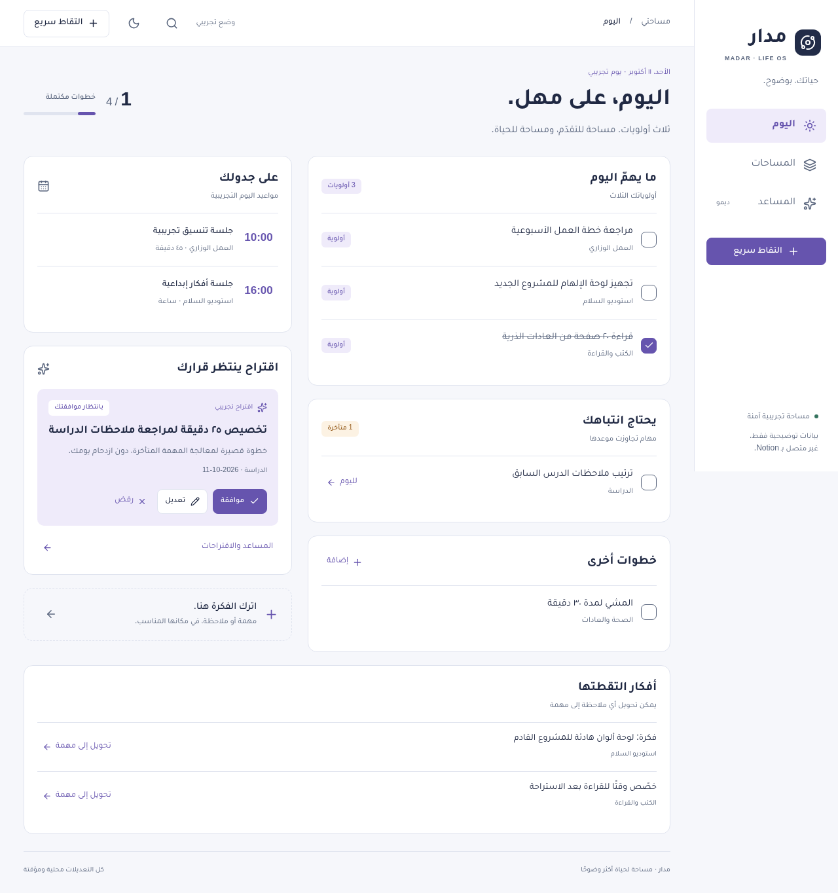
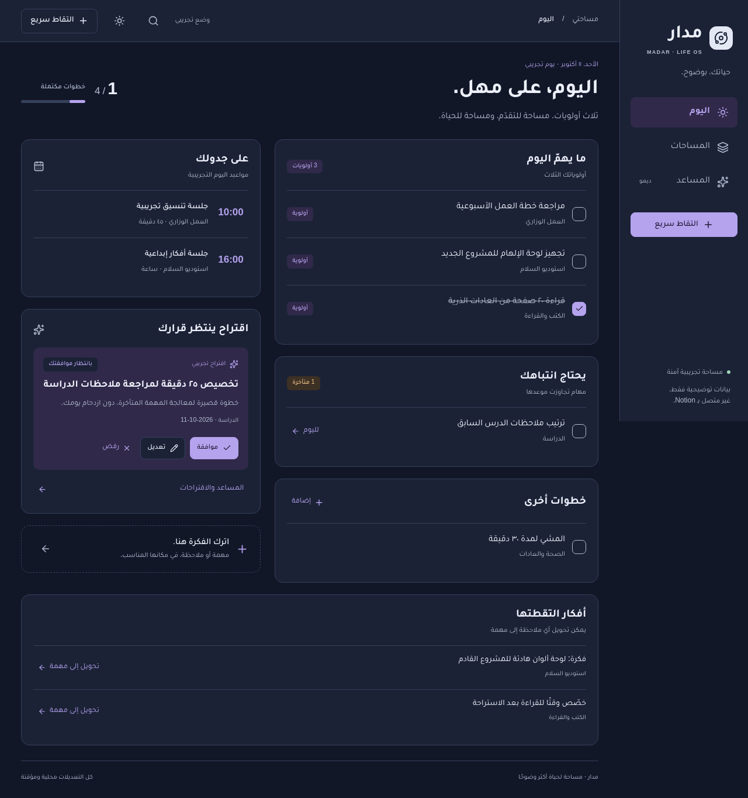
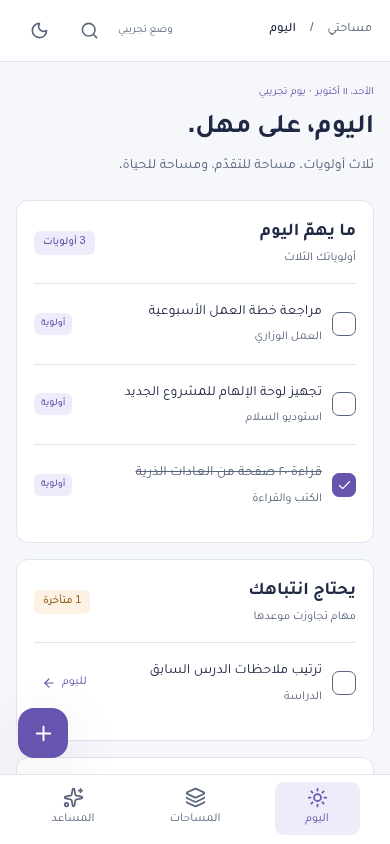
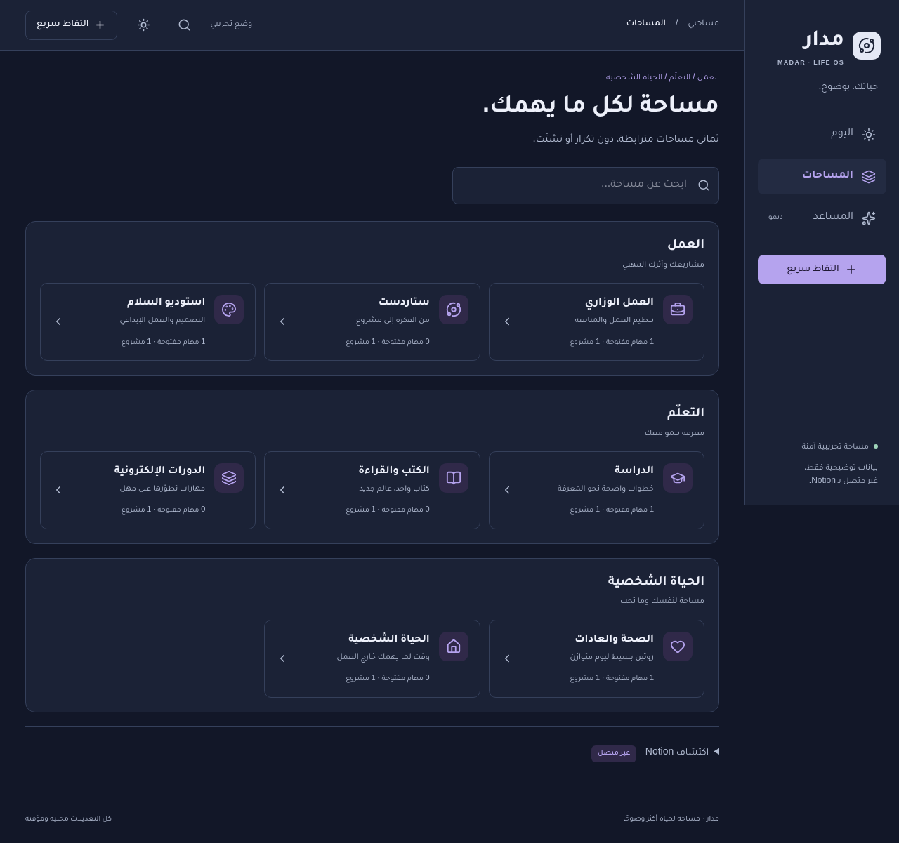
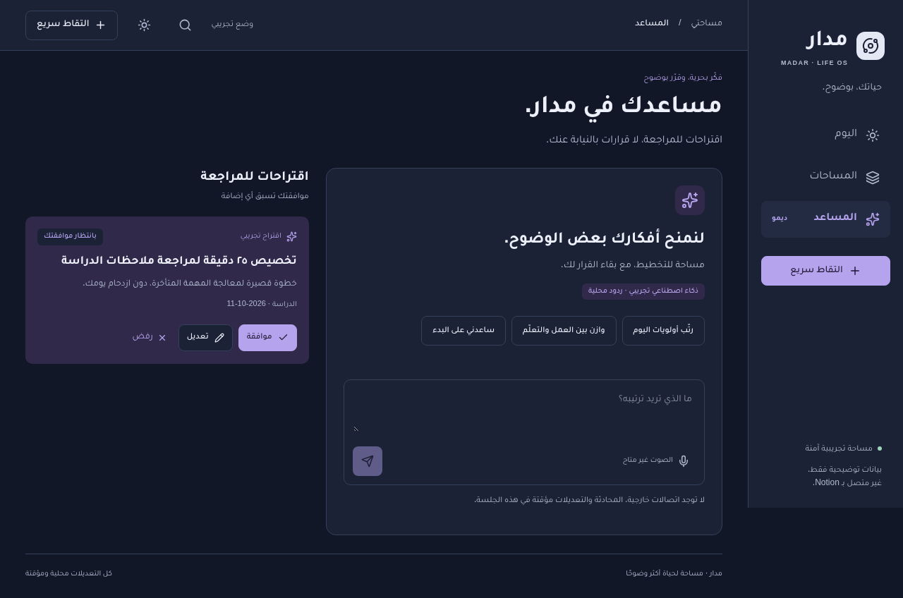

# MADAR redesign review

Historical Phase 1 review. For the current navy/red branding, real optional AI/voice adapters and owner-only site, see [single-owner guide](./single-owner.md). The unavailable services below describe this earlier snapshot.

The existing `/` dashboard now presents a simpler Arabic-first personal operating system rather than a collection of unrelated task cards. The navy/lavender design system supports light and dark themes, bundled Tajawal typography, and mobile bottom navigation with global quick capture.

## Functional in this demo

- Shared task completion across Today and Spaces.
- Overdue rescheduling to the fixed demo day.
- Global task/note capture with space selection; note conversion retains record identity.
- Global search across tasks, notes and spaces.
- All eight spaces grouped under Work, Learning and Personal, each with five accessible section tabs.
- Proposal editing, approval and rejection. Approval adds a single session-only task; repeating a decision never duplicates it.
- Local conversation, theme toggle, session-only habit check-in, keyboard tabs and modal focus management.

## Illustrative or unavailable

AI responses are deterministic local examples, not an integrated language model. Voice is unavailable and never records. Reading/course summaries, projects and appointments are static synthetic examples. Notion Discovery is an expandable future-feature description. No Notion data is read, changed or saved; no external API keys or integrations are introduced.

Only theme preference persists in browser localStorage. Other changes reset on reload. The app uses an explicitly labelled fixed demo date rather than claiming these records describe the current day.

## Validation

- `npm run lint`: passed without warnings.
- `npm run typecheck`: passed in strict mode.
- `npm test`: 8 model tests passed.
- `npm run build`: passed; the existing `/` route is retained.
- `MADAR_CHROMIUM_PATH=/usr/bin/chromium npm run test:e2e`: 7 production-browser tests passed, including desktop/mobile flows and axe WCAG A/AA scans of all three destinations in both themes and the capture dialog. No page errors or external requests were observed in the checked assistant/capture flows.

Automated checks supplement review; they do not establish complete accessibility conformance or cross-browser coverage. Chromium was tested, not Firefox or WebKit.

## Screenshots

## Review boundary

Feature branch: `feature/madar-premium-redesign`. No merge to `main` or production deployment is authorized. Vercel Root Directory remains the repository root (`./`).
